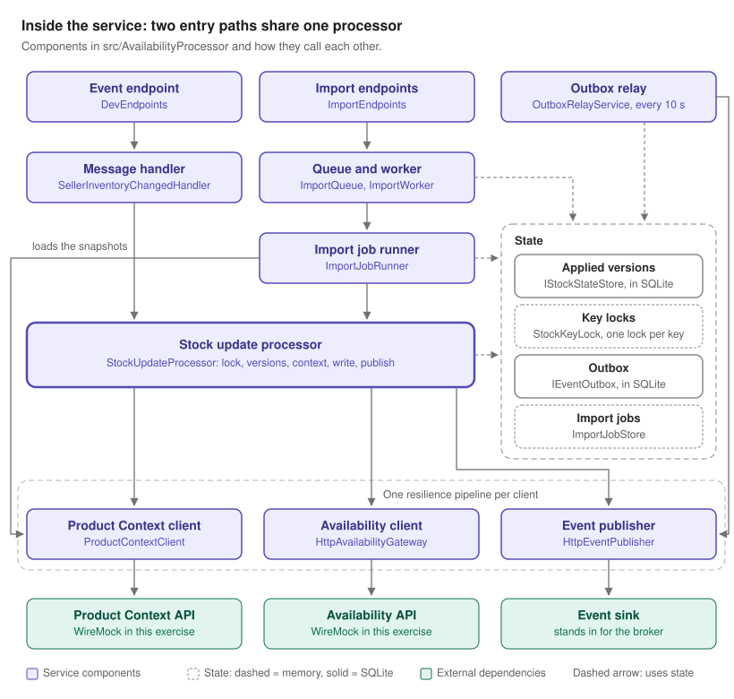

# Size-Level Availability Processor

This repository is my solution to the take-home exercise "Size-Level Availability Processor".

It is an ASP.NET Core (.NET 10) service. It receives stock changes from sellers, looks up the canonical product data, writes the stock to the Availability API and publishes a `SizeAvailabilityUpdated` event.

> GitHub shows this page because it is in the `.github` folder. The `README.md` in the root is the one that came with the exercise, and it is unchanged.

## What the service does

A stock change arrives in one of two ways. Both go through the same processing code.

| Input | Endpoint | Response |
|---|---|---|
| One inventory event, as JSON | `POST /_dev/messages` | After the event is processed: `200`, `400`, `422` or `503` |
| A stock file, as CSV (10,000 rows in the sample) | `POST /v1/availability/imports` | At once: `202` and a `jobId`. The rows are processed in the background, and `GET /v1/availability/imports/{jobId}` returns the progress |

For each change, the service does five things:

1. It skips the change if the same or a newer version of that stock is already applied.
2. It reads the product context: one lookup for an event, one snapshot per country for a file.
3. It writes the stock to the Availability API.
4. It records the version and the output event in one database transaction.
5. It publishes the event. If publishing fails, a background relay publishes the event later.



## What is in this repository

| Path | Contents | Origin |
|---|---|---|
| `Take-Home Exercise_ Size-Level Availability Processor.pdf` | The assignment | Provided |
| [README.md](../README.md) | How to start the provided mocks | Provided |
| `compose.yaml` and `wiremock/` | WireMock mocks of the three dependencies, and the sample files | Provided |
| [SOLUTION.md](../SOLUTION.md) | The README of the solution: how to run it, the API, the design decisions and the trade-offs | Solution |
| `src/AvailabilityProcessor` | The service | Solution |
| `tests/AvailabilityProcessor.Tests` | 65 automated tests | Solution |
| [docs/architecture.md](../docs/architecture.md) | 11 diagrams, from the systems around the service to each request, step by step | Solution |
| [docs/test-traceability.md](../docs/test-traceability.md) | Each requirement of the brief, and the tests that check it | Solution |

The provided files are unchanged.

## Run it

Prerequisites: the .NET 10 SDK, and Docker for the provided mocks.

```powershell
docker compose up -d                               # the provided mocks, on port 8080
dotnet run --project src/AvailabilityProcessor     # the service, on port 5000
dotnet test                                        # the tests; Docker is not needed
```

The sample requests are in [SOLUTION.md](../SOLUTION.md#quick-start).

## Main design decisions

- **One processing path.** Events and CSV rows go through the same `StockUpdateProcessor`, so the same rules apply to both.
- **Versions per stock key.** The key is the seller, the product, the size and the country. A lower version is skipped as stale, and an equal version as a duplicate, even when it arrives with a new `eventId`.
- **One update per key at a time.** A lock per stock key stops an older version from being written after a newer one. This also holds when an event arrives while an import is running.
- **Failures of a dependency.** Only transient failures are retried, and `Retry-After` is honoured. A circuit breaker per dependency stops the calls while that dependency is down.
- **No lost events.** The applied version and the output event are stored in one SQLite transaction (a transactional outbox). A relay publishes the events that could not be published at once.
- **Bulk imports.** The upload is answered at once. A background worker loads one snapshot per country and matches the rows by key, in O(n + m) time.

## Where each topic of the brief is answered

| Topic | Section of SOLUTION.md |
|---|---|
| Duplicates, replays and stale updates | [Versions, duplicates and stale updates](../SOLUTION.md#versions-duplicates-and-stale-updates) |
| Unknown, inactive and disabled products | [Unknown, inactive and disabled products](../SOLUTION.md#unknown-inactive-and-disabled-products) |
| Retries and idempotency | [Retries](../SOLUTION.md#retries) |
| A write that succeeds when publishing fails | [Gateway write succeeded, but publishing failed](../SOLUTION.md#gateway-write-succeeded-but-publishing-failed) |
| Partial failures of a bulk import | [Bulk imports and partial failures](../SOLUTION.md#bulk-imports-and-partial-failures) |
| Concurrency and flow control | [Concurrency and flow control](../SOLUTION.md#concurrency-and-flow-control) |
| Crashes and restarts | [Crashes, restarts and atomicity](../SOLUTION.md#crashes-restarts-and-atomicity) |
| Time and space complexity of the bulk matching | [Bulk context matching](../SOLUTION.md#bulk-context-matching-time-and-space-complexity) |
| Production broker | [Production broker: Kafka](../SOLUTION.md#production-broker-kafka) |
| Assumptions | [Assumptions](../SOLUTION.md#assumptions) |
| Next steps | [What I would do next](../SOLUTION.md#what-i-would-do-next) |

## Limits

The service runs as a single instance. The database is a local SQLite file, and the import jobs and the key locks are in memory. [What production would add](../SOLUTION.md#what-production-would-add) describes how each of these would change.
