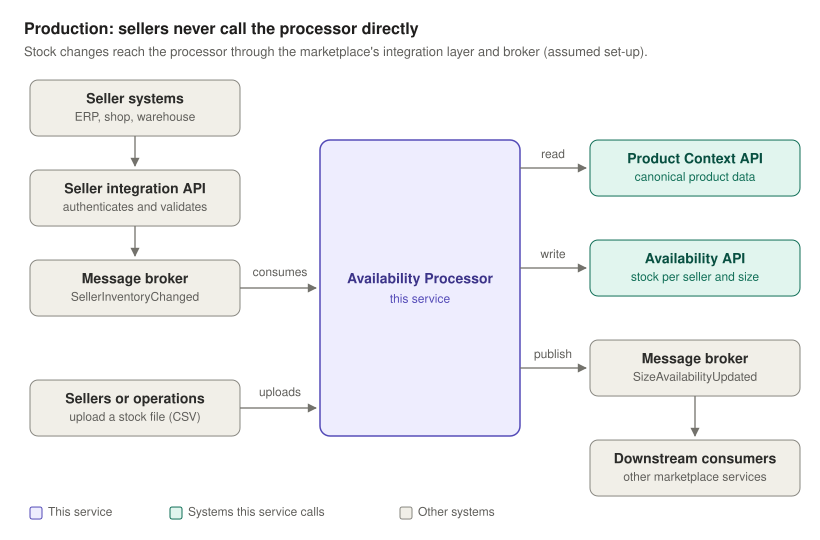
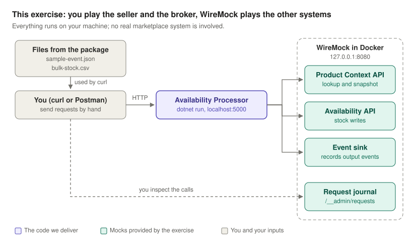
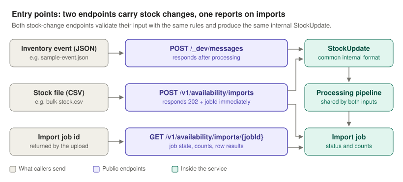
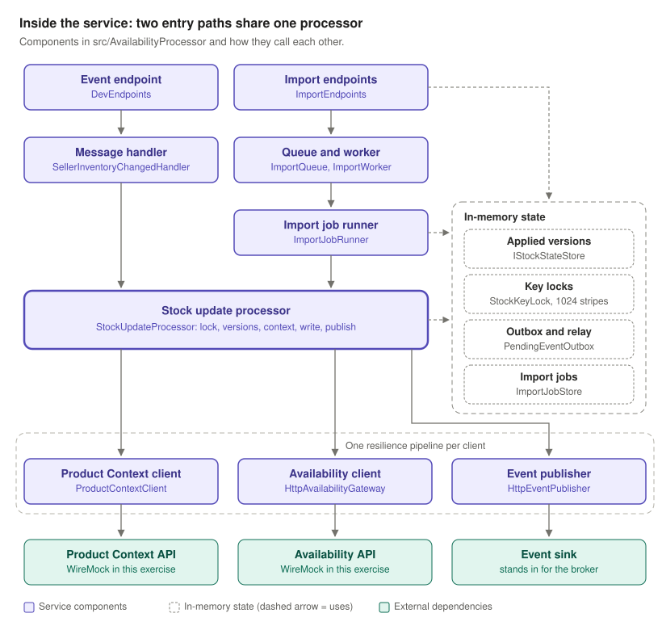
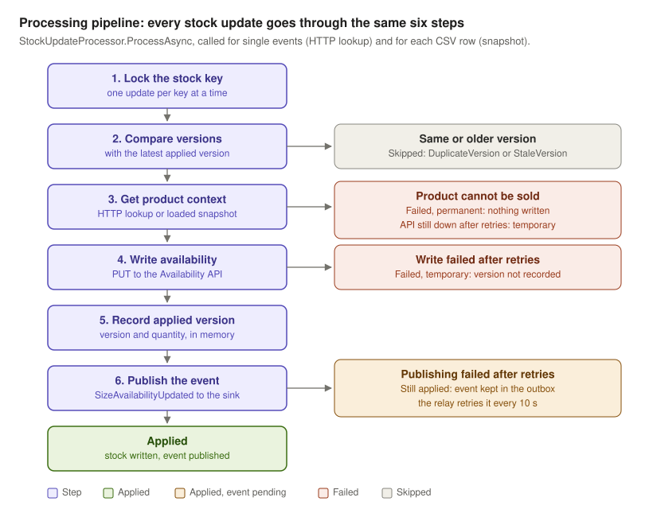
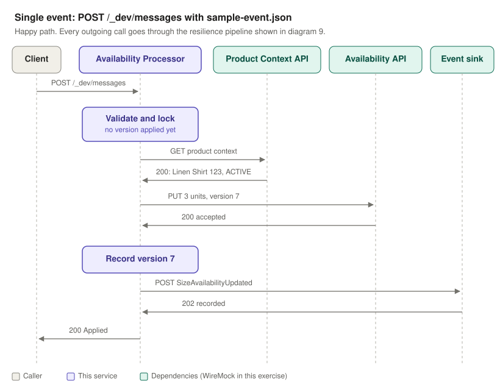
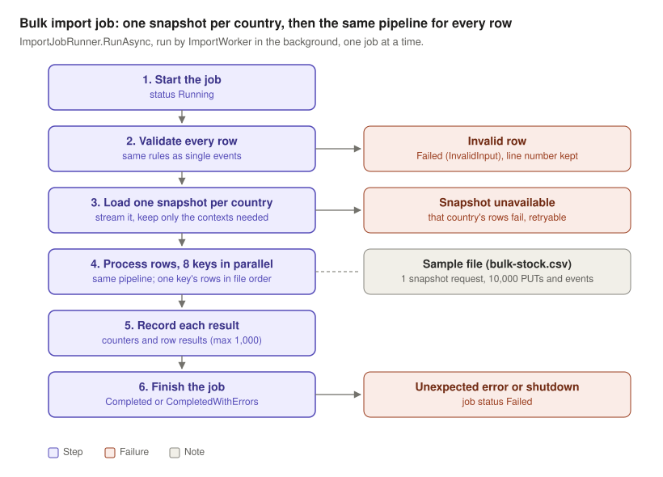
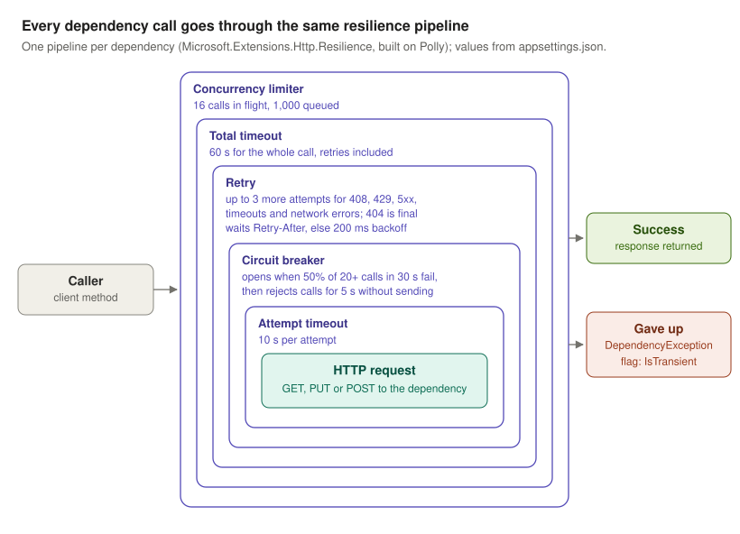
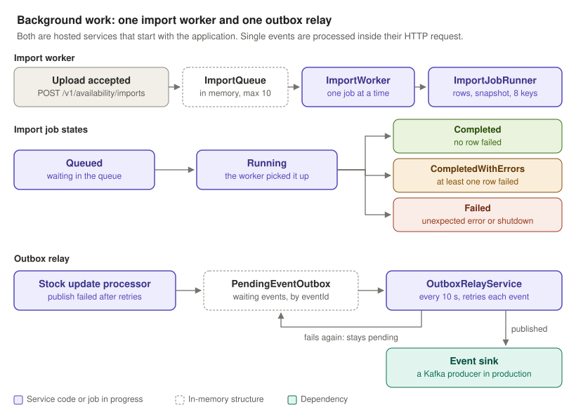
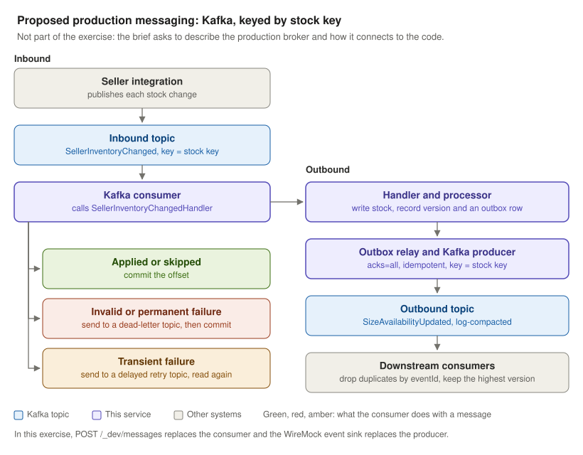

# Architecture diagrams

The diagrams are grouped in three parts:

- **1 to 4:** how the Availability Processor connects to its callers and to the services it depends on, up to its entry points.
- **5 to 9:** how it works inside.
- **10 and 11:** its background work and the proposed production messaging.

The design decisions behind them are described in [SOLUTION.md](../SOLUTION.md).

## 1. Production context

- Sellers do not call this service. Their stock changes reach the marketplace first, and an integration layer publishes them to a broker as `SellerInventoryChanged` events. This integration layer is an assumption: the brief only states that events arrive through a broker.
- The processor consumes those events. It also accepts stock files uploaded through `POST /v1/availability/imports`.
- For each change it does three things:
  1. reads canonical product data from the Product Context API;
  2. writes the stock to the Availability API;
  3. publishes a `SizeAvailabilityUpdated` event for downstream consumers.

## 2. Local set-up for this exercise

- There is no seller and no broker locally. You send requests by hand with `curl` or Postman, using the sample files in `wiremock/__files`.
- `POST /_dev/messages` stands in for the broker. It receives one `SellerInventoryChanged` event and calls the same handler that a broker consumer would call.
- WireMock is started with `docker compose up -d`. It stands in for three systems:
  - the Product Context API;
  - the Availability API;
  - the output broker, as an HTTP event sink.
- WireMock's request journal shows every call the service made.

## 3. Entry points

| Endpoint | Input | Responses | When the work happens |
|---|---|---|---|
| `POST /_dev/messages` | One `SellerInventoryChanged` JSON event | `200` applied or skipped; `400` invalid message; `422` cannot be applied (unknown, inactive or disabled product); `503` dependency unavailable, retry later | Before the response |
| `POST /v1/availability/imports` | A CSV with the columns `sellerId,productId,sizeId,countryCode,availableQuantity,sourceVersion`, sent as `multipart/form-data` in a field named `file` | `202` with `jobId` and a `Location` header; `400` no file, unreadable form body or bad header; `413` upload over the size limit; `415` unsupported media type; `503` import queue full | In the background |
| `GET /v1/availability/imports/{jobId}` | The job id returned by the upload | `200` job status; `404` unknown job | Read-only |

Both stock-change endpoints validate their input with the same rules and convert it into a `StockUpdate`. After that point, the processing pipeline handles every change the same way, whichever endpoint it came from.

## 4. Bulk import lifecycle

- The HTTP request checks the media type, that a file is present and the header. It then queues the job and returns before any row is processed.
- A background worker takes over:
  1. it validates the rows;
  2. it loads one Product Context snapshot per country in the file;
  3. it sends every valid row through the same pipeline as single events.
- Clients poll `GET /v1/availability/imports/{jobId}` until the status is `Completed`, `CompletedWithErrors` or `Failed`.

## 5. Inside the service

- There are two entry paths:
  - **single events:** `DevEndpoints` calls `SellerInventoryChangedHandler`;
  - **files:** `ImportEndpoints` queues a job, and `ImportWorker` runs `ImportJobRunner` in the background.
- Both paths end in `StockUpdateProcessor`, the only place where a stock change is applied.
- The processor uses in-memory state: applied versions, key locks and the outbox. It reaches the outside world through three HTTP clients, each behind its own resilience pipeline.
- All state is in memory and is lost on restart. In production it would live in a database (see SOLUTION.md).

## 6. Processing pipeline

- Every stock update goes through the same steps. Only the source of product context differs: an HTTP lookup for single events, the loaded snapshot for imports.
- The key lock covers steps 2 to 5. An older update can never be written after a newer one for the same stock key, even when an event and a CSV row for that key are processed at the same time.
- The version is recorded right after the availability write and before publishing. A failed write leaves it unrecorded, so a redelivered message can still be applied.
- If publishing keeps failing, the update stays applied and the event waits in the outbox. `OutboxRelayService` retries it every 10 seconds with the same deterministic `eventId`, so consumers can drop duplicates.

## 7. Single event, step by step

- For `sample-event.json`, the happy path is one lookup, one write and one event, followed by `200 Applied`.
- The processing result is mapped to an HTTP status:

  | Result | Status |
  |---|---|
  | `Applied` or `Skipped` | `200` |
  | Invalid message | `400` |
  | Product that cannot be sold | `422` |
  | Dependency still failing after retries | `503` |

## 8. Bulk import job

- Rows are validated first. An invalid row fails on its own and keeps its line number.
- The service requests one snapshot per country, streams the response and keeps only the contexts the rows need: 10,000 of 50,000 for the sample file.
- Up to 8 stock keys are processed in parallel, and rows of the same key keep their file order.
- The job ends in one of three states:
  - `Completed` when no row failed;
  - `CompletedWithErrors` when at least one row failed;
  - `Failed` when the job itself stops, for example on shutdown.

## 9. Calls to dependencies

- Each dependency (Product Context API, Availability API, event sink) has its own pipeline. The values are set in the `Resilience` section of `appsettings.json`.
- Only transient failures are retried: `408`, `429`, `5xx`, timeouts and network errors. `404` and the other `4xx` responses are final.
- The limiter is the outermost layer, so a call keeps its permit while it waits to retry. A burst of `429` responses therefore slows callers down instead of piling up more requests.
- The circuit breaker sits inside the retry, so every attempt counts. When at least half of 20 or more calls in 30 seconds have failed, it rejects calls for 5 seconds without sending them. A rejected call is not retried: it fails at once as a transient failure.
- When the pipeline gives up, the client throws a `DependencyException`. Its `IsTransient` flag tells the processor whether the failure is temporary or permanent.

## 10. Background work

- Only two things run in the background. Both are hosted services that start with the application:
  - `ImportWorker`;
  - `OutboxRelayService`.
- Single events are processed inside their HTTP request.
- **Import jobs:**
  - An upload creates an import job and puts it in an in-memory queue. The queue holds at most 10 jobs; when it is full, the upload gets `503`.
  - `ImportWorker` runs one job at a time. The job moves from `Queued` to `Running` and ends as `Completed`, `CompletedWithErrors` or `Failed`.
  - Jobs are kept in memory, so they are lost on restart.
- **Outbox relay:**
  - Every 10 seconds, `OutboxRelayService` tries to publish each pending event once.
  - A published event leaves the outbox. A failed one stays and is retried on the next tick.
  - Events are stored under their deterministic `eventId`, so the same event is never queued twice. `GET /_dev/outbox` shows what is pending.

## 11. Proposed production messaging

- This is not part of the exercise. The brief asks to describe the production broker and how it would connect to the code. This is the proposal, and the topic layout is illustrative.
- Both topics use the stock key (seller, product, size, country) as the message key. All messages for one key land in the same partition and are read in order by a single consumer. With several service instances, this replaces the in-memory key lock.
- The consumer calls the same `SellerInventoryChangedHandler` as `POST /_dev/messages` and acts on the result:
  - applied or skipped: it commits the offset;
  - invalid message or permanent failure: it sends the message to a dead-letter topic, then commits;
  - transient failure: it sends the message to a delayed retry topic, so the partition is not blocked.
- The applied version and the outbound event are written in one database transaction, as an outbox row. A relay publishes the row with an idempotent Kafka producer, which replaces the in-memory outbox and the HTTP event sink.
- The outbound topic is log-compacted, so new consumers can read the latest availability per key. Delivery is at least once: consumers drop duplicates by `eventId` and keep the highest `sourceVersion` per key.
- Alternatives that also keep per-key order:
  - Azure Service Bus with sessions;
  - Amazon SQS FIFO with message groups;
  - RabbitMQ with a consistent-hash exchange or a single active consumer.
