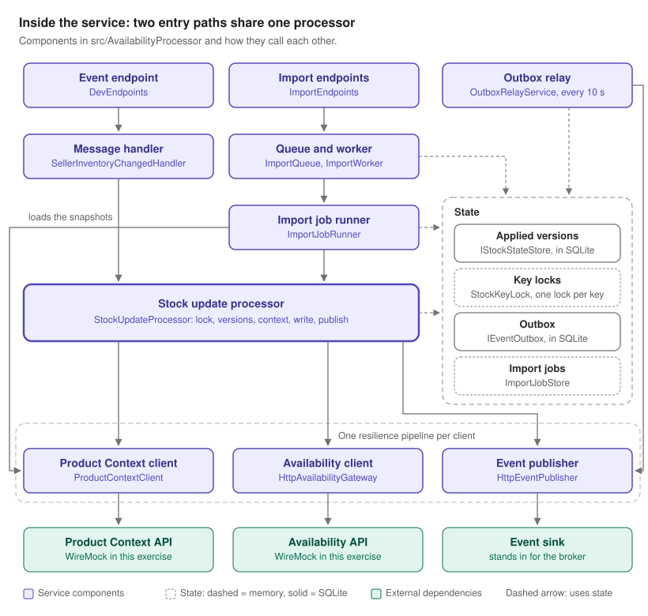
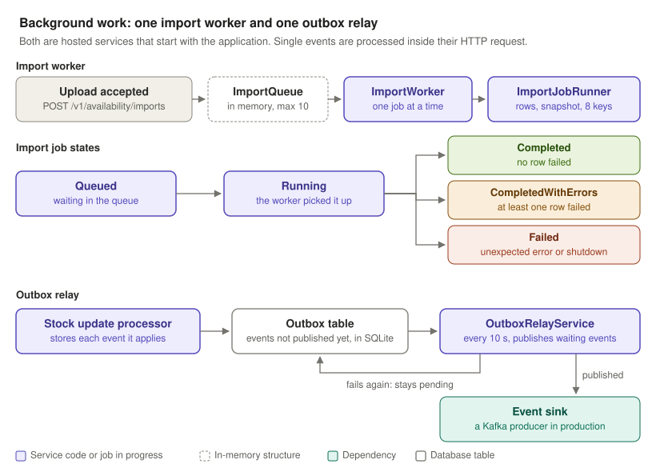
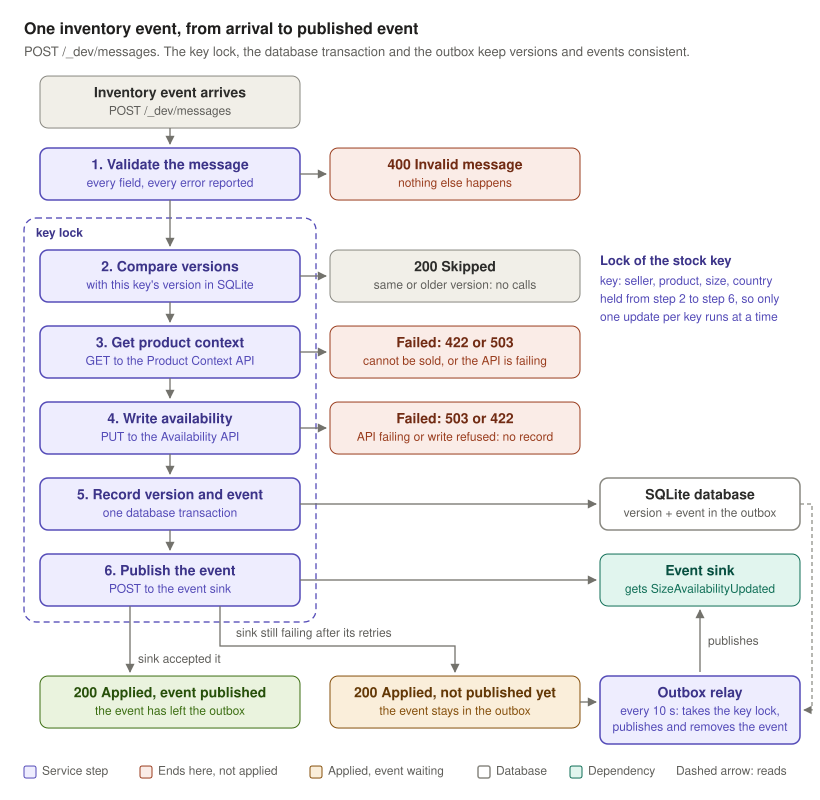
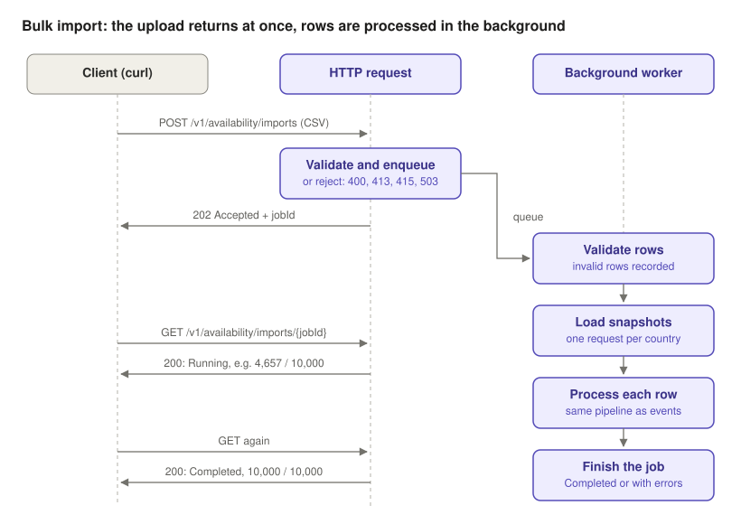
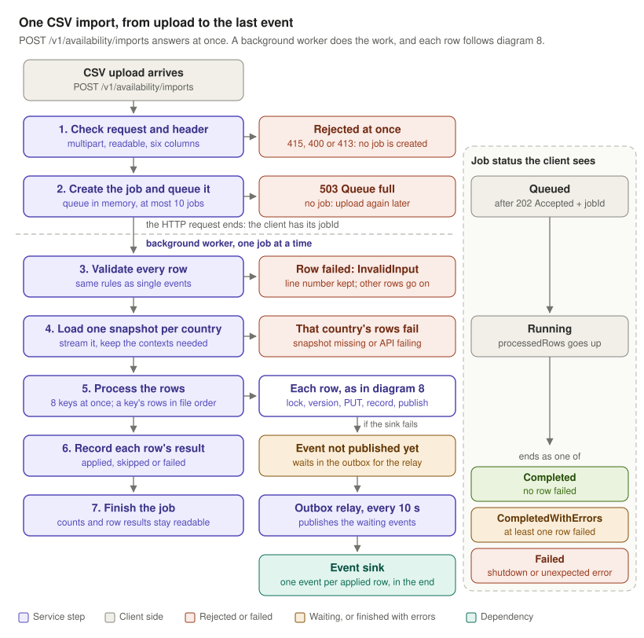

# Architecture diagrams

The diagrams are in three folders under `docs/diagrams`, one for each type of diagram. The numbers give the reading order.

| Folder | What its diagrams show | Diagrams |
|---|---|---|
| `context` | The service among the systems around it: in production, in this exercise and with the proposed broker | 1, 2 and 11 |
| `structure` | What the service is made of: its endpoints, its components, its calls to dependencies and its background work | 3 to 6 |
| `flows` | What happens to a request, step by step: one event and one CSV import | 7 to 10 |

The design decisions behind them are described in [README.md](../README.md).

## 1. Production context

- Sellers do not call this service. Their stock changes reach the marketplace first, and an integration layer publishes them to a broker as `SellerInventoryChanged` events. This integration layer is an assumption: the brief only states that events arrive through a broker.
- The processor consumes those events. It also accepts stock files uploaded through `POST /v1/availability/imports`.
- For each change it does three things:
  1. reads canonical product data from the Product Context API;
  2. writes the stock to the Availability API;
  3. publishes a `SizeAvailabilityUpdated` event for downstream consumers.

## 2. Local set-up for this exercise

- There is no seller and no broker locally. You send requests by hand with `curl` or Postman, using the sample files in `wiremock/__files`.
- `POST /_dev/messages` stands in for the broker. It receives one `SellerInventoryChanged` event and calls the same handler that a broker consumer would call.
- WireMock is started with `docker compose up -d`. It stands in for three systems:
  - the Product Context API;
  - the Availability API;
  - the output broker, as an HTTP event sink.
- WireMock's request journal shows every call the service made.

## 3. Entry points

| Endpoint | Input | Responses | When the work happens |
|---|---|---|---|
| `POST /_dev/messages` | One `SellerInventoryChanged` JSON event | `200` applied or skipped; `400` invalid message; `415` body that is not JSON; `422` cannot be applied (unknown, inactive or disabled product); `503` dependency unavailable, retry later | Before the response |
| `POST /v1/availability/imports` | A CSV with the columns `sellerId,productId,sizeId,countryCode,availableQuantity,sourceVersion`, sent as `multipart/form-data` in a field named `file` | `202` with `jobId` and a `Location` header; `400` no file, unreadable form body or bad header; `413` upload over the size limit; `415` unsupported media type; `503` import queue full | In the background |
| `GET /v1/availability/imports/{jobId}` | The job id returned by the upload | `200` job status; `404` unknown job | Read-only |

- Both stock-change endpoints validate their input with the same rules and convert it into a `StockUpdate`. After that point, the same processing steps handle every change, whichever endpoint it came from (diagram 8).
- Three more routes only read state and are not in the diagram: `GET /health`, `GET /_dev/stock/{sellerId}/{productId}/{sizeId}` and `GET /_dev/outbox`.

## 4. Inside the service

- There are two entry paths:
  - **single events:** `DevEndpoints` calls `SellerInventoryChangedHandler`;
  - **files:** `ImportEndpoints` queues a job, and `ImportWorker` runs `ImportJobRunner` in the background.
- Both paths end in `StockUpdateProcessor`, the only place where a stock change is applied.
- The processor keeps the applied versions and the outbox in a SQLite database (`SqliteStockStore`), and the key locks in memory. It reaches the outside world through three HTTP clients, each behind its own resilience pipeline.
- `ImportJobRunner` also calls the Product Context client itself, to load one snapshot per country.
- `OutboxRelayService` is the second background service. It reads the outbox and publishes the waiting events through the event publisher (diagram 6).
- The database survives a restart. The key locks and the import jobs are in memory and do not. In production the database would be a server shared by all instances (see README.md).

## 5. Calls to dependencies

- Each dependency (Product Context API, Availability API, event sink) has its own pipeline. The values are set in the `Resilience` section of `appsettings.json`.
- Only transient failures are retried: `408`, `429`, `5xx`, timeouts and network errors. `404` and the other `4xx` responses are final.
- The limiter is the outermost layer, so a call keeps its permit while it waits to retry. A burst of `429` responses therefore slows callers down instead of piling up more requests.
- The circuit breaker sits inside the retry, so every attempt counts. When at least half of 20 or more calls in 30 seconds have failed, it rejects calls for 5 seconds without sending them. A rejected call is not retried: it fails at once as a transient failure.
- When the pipeline gives up, the client throws a `DependencyException`. Its `IsTransient` flag tells the processor whether the failure is temporary or permanent.

## 6. Background work

- Only two things run in the background. Both are hosted services that start with the application:
  - `ImportWorker`;
  - `OutboxRelayService`.
- Single events are processed inside their HTTP request.
- **Import jobs:**
  - An upload creates an import job and puts it in an in-memory queue. The queue holds at most 10 jobs; when it is full, the upload gets `503`.
  - `ImportWorker` runs one job at a time. The job moves from `Queued` to `Running` and ends as `Completed`, `CompletedWithErrors` or `Failed`.
  - Jobs are kept in memory, so they are lost on restart.
- **Outbox relay:**
  - The processor stores every output event in the outbox, together with the applied version, and removes the event once the sink has accepted it. The outbox therefore holds the events that are not published yet.
  - The outbox is a table in the SQLite database, so the waiting events survive a restart.
  - Every 10 seconds, `OutboxRelayService` runs `OutboxRelay`, which tries to publish the oldest waiting events once.
  - A published event leaves the outbox. A failed one stays and is retried on the next run. When the sink is failing, the run stops at the first failure.
  - Before it publishes an event, the relay takes the lock of the event's stock key. The processor publishes under the same lock, so an event is never published by both at the same moment.
  - Events are stored under their deterministic `eventId`, so the same event is never queued twice. `GET /_dev/outbox` shows what is waiting.

## 7. Single event, step by step

- For `sample-event.json`, the happy path is one lookup, one write and one event, followed by `200 Applied`.
- The processing result is mapped to an HTTP status:

  | Result | Status |
  |---|---|
  | `Applied` or `Skipped` | `200` |
  | Invalid message | `400` |
  | Product that cannot be sold | `422` |
  | Dependency still failing after retries | `503` |

- Diagram 8 shows the same request with every outcome.

## 8. One event, from arrival to published event

- This diagram follows one event to the end. It adds what diagram 7 leaves out: the key lock, the database transaction and the outbox.
- **Shared steps.** Steps 2 to 6 are `StockUpdateProcessor`. Every stock update goes through them, and so does each row of a CSV import. Only the source of product context differs: an HTTP lookup for single events, the loaded snapshot for imports.
- **Versions.** A version equal to the applied one is skipped as `DuplicateVersion`, and an older one as `StaleVersion`. Neither causes a call to a dependency.
- **Key lock.** The stock key is the seller, the product, the size and the country. Steps 2 to 6 run under the lock of that key, so two updates of the same key never run at the same time. Without the lock, an older version that is still being written could reach the Availability API after a newer one.
- **Failed write.** Step 4 gets `503` when the Availability API keeps failing, so the sender tries again later, and `422` when the API refuses the write. In both cases nothing is recorded, so the same message can still be applied when it is delivered again.
- **Outbox.** Step 5 stores the applied version and the output event in one transaction, right after the availability write. From then on the event cannot be lost. Step 6 publishes it straight away, and the event leaves the outbox once the sink has accepted it.
- **When the sink keeps failing,** the caller still gets `200`, because the stock has changed. The event stays in the outbox, and the relay publishes it later, under the same key lock and with the same deterministic `eventId`, so consumers can drop duplicates.

## 9. Bulk import lifecycle

- The HTTP request checks the media type, that a file is present and the header. It then queues the job and returns before any row is processed.
- A background worker takes over:
  1. it validates the rows;
  2. it loads one Product Context snapshot per country in the file;
  3. it sends every valid row through the same steps as single events.
- Clients poll `GET /v1/availability/imports/{jobId}` until the status is `Completed`, `CompletedWithErrors` or `Failed`.
- Diagram 10 shows the same import with every failure, the outbox and the job states.

## 10. One CSV import, from upload to the last event

- Steps 1 and 2 are the HTTP request. They only decide whether the file can be accepted. Everything below the dashed line happens in the background, and the client follows it with `GET /v1/availability/imports/{jobId}`.
- A row never rejects the file. An invalid row, a missing context or a failed write fails that row only, and an invalid row keeps its line number.
- Step 4 requests one snapshot per country, streams the response and keeps only the contexts the rows need: 10,000 of 50,000 for the sample file.
- Each row goes through steps 2 to 6 of diagram 8, with the snapshot as its source of product context. Up to 8 stock keys are processed in parallel, and rows of the same key keep their file order. An event that could not be published waits in the outbox, as for single events.
- For the sample file (`bulk-stock.csv`), a first import makes 1 snapshot request, 10,000 availability writes and 10,000 events.
- The job ends in one of three states:
  - `Completed` when no row failed;
  - `CompletedWithErrors` when at least one row failed;
  - `Failed` when the job itself stops, for example on shutdown.
- The job status lists at most 1,000 rows that were not applied, failed rows first; the counts are always exact.
- The job itself is kept in memory; the versions and the events it produced are in the database.

## 11. Proposed production messaging

- This is not part of the exercise. The brief asks to describe the production broker and how it would connect to the code. This is the proposal, and the topic layout is illustrative.
- Both topics use the stock key (seller, product, size, country) as the message key. All messages for one key land in the same partition and are read in order by a single consumer. With several service instances, this replaces the in-memory key lock.
- The consumer calls the same `SellerInventoryChangedHandler` as `POST /_dev/messages` and acts on the result:
  - applied or skipped: it commits the offset;
  - invalid message or permanent failure: it sends the message to a dead-letter topic, then commits;
  - transient failure: it sends the message to a delayed retry topic, so the partition is not blocked.
- As today, the applied version and the outbound event are written in one database transaction, as an outbox row. A relay publishes the row with an idempotent Kafka producer, which replaces the HTTP event sink.
- The outbound topic is log-compacted, so new consumers can read the latest availability per key. Delivery is at least once: consumers drop duplicates by `eventId` and keep the highest `sourceVersion` per key.
- Alternatives that also keep per-key order:
  - Azure Service Bus with sessions;
  - Amazon SQS FIFO with message groups;
  - RabbitMQ with a consistent-hash exchange or a single active consumer.
